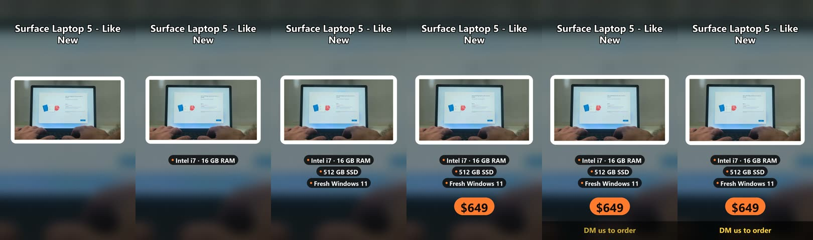

# product-reel

**One product photo plus a few words in, a vertical promo Reel out.** An n8n form plus a small Python video service, made for shops that want a Reel for every product without opening an editor.



## How it works

```
n8n Form ──► Code node ──► HTTP Request ──► Form ending
(photo,      (photo to     (POST /reel to     (returns the MP4
 title,       base64 JSON)  the local service)  as a download)
 price,
 features)
```

1. **Form Trigger**: a hosted web form with a photo upload, title, price, features (one per line) and a call to action.
2. **Code node**: reads the uploaded photo's binary data and builds the JSON body.
3. **HTTP Request**: calls `reel.py --serve` on `127.0.0.1:8777` and gets the video back as a binary file.
4. **Form ending (Return Binary File)**: the browser downloads `reel.mp4` right after submitting.

The video itself is 1080×1920 and 11 seconds long:
- a blurred, darkened copy of the photo fills the frame
- the sharp photo sits on a white card that slowly zooms in with an ease-out
- the title fades in, then each feature appears in turn
- an orange price badge and a call-to-action bar finish it off

Everything is rendered with Pillow layers and one ffmpeg pass, in a couple of seconds.

## Run it

```bash
pip install -r requirements.txt        # Pillow; ffmpeg must be installed too
python reel.py --serve                 # the video service on 127.0.0.1:8777
n8n import:workflow --input=product-reel.workflow.json
n8n publish:workflow --id=<id>         # then restart n8n and open /form/<webhookId>
```

Or use it without n8n:

```bash
python reel.py laptop.jpg "ThinkPad T14 Gen 3" --price "$649" \
  --features "i7 · 16 GB RAM" "512 GB SSD" --cta "DM us to order" --out reel.mp4
```

## Design notes

- The video work runs in a separate service instead of n8n's Execute Command node, which n8n 2.x disables by default for good reason. The service listens only on localhost and takes exactly one shape of request.
- Errors come back as JSON (`{"error": ...}`) so the n8n execution log shows the real reason.
- Features can be sent as a list or as one newline-separated string, which is what a textarea gives you.

## License

MIT
